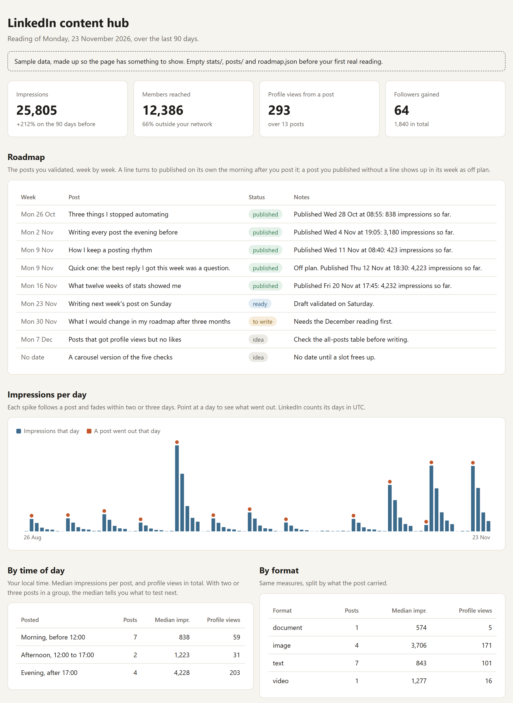

# linkedin-content-hub

The small system behind my LinkedIn posting: a roadmap of the posts I have validated, a task that reads my LinkedIn analytics every weekday morning, and a dashboard that shows what works. I still write and publish every post myself. The system keeps the books.



## What it does

- **The roadmap** (`roadmap.json`) holds the posts I have validated, one line per week, each pointing to its draft in `posts/drafts/`. When a week starts, the post is already written.
- **A scheduled task** runs in the Claude desktop app every morning at 9:30. Through the Claude in Chrome extension it opens my LinkedIn analytics, read-only, and records each post's numbers, the 90-day totals and the day-by-day curve in `stats/`.
- **Published posts file themselves.** When the task finds a post with no archive, it reads its text, saves it in `posts/` along with the draft it came from, deletes the draft and marks the roadmap line as published. A post I published off plan is archived too, and shows up in its week.
- **The dashboard** (`dashboard.html`, one file, no server) shows the roadmap, impressions per day with the days I posted, and the median impressions of a post by time of day and by format.

## How a week goes

1. I write a draft in `posts/drafts/`, as plain text ready to paste, and add its line to `roadmap.json`: the week's Monday, the status `ready`, and the draft's file name in `draft` (that name is how the line gets ticked off).
2. I publish it on LinkedIn myself, when I want.
3. The next weekday morning, the task records the numbers, archives the post, ticks its line off and rebuilds the dashboard.
4. Once a week, I open the dashboard and fill the next weeks of the roadmap.

## What's in the repo

| Path | What it is |
|---|---|
| `roadmap.json` | The validated posts, week by week. Statuses: `idea`, `to write`, `ready`, `published`. |
| `posts/drafts/` | Drafts waiting to go out, one `.txt` per post. |
| `posts/` | Each published post, word for word, followed by the draft it came from. |
| `stats/` | One row per post and per reading (`posts.csv`), the 90-day totals (`totals.csv`), the day-by-day curve (`days.csv`). |
| `routine/daily-linkedin-reading.md` | The prompt of the scheduled task, and how to install it. |
| `scripts/record_stats.py` | Writes one reading into `stats/`. |
| `scripts/archive_posts.py` | Archives published posts and ticks them off the roadmap. |
| `scripts/build_dashboard.py` | Builds `dashboard.html` from `roadmap.json` and the latest reading. |
| `inbox/` | Where the task writes what it read (`reading.json`, `posts-read.json`) before calling the scripts. Ignored by Git. |
| `examples/` | One example of each file the task writes in `inbox/`. |
| `tests/` | Runs the whole chain on a temporary copy. |

The roadmap, posts and stats in this repo are made-up sample data, so the dashboard has something to show.

## What you need

- The Claude desktop app, for its scheduled tasks (Code tab, Scheduled in the sidebar), on a direct Anthropic plan (Pro, Max, Ultra, Team or Enterprise): the Chrome integration does not work with an API key.
- The Claude in Chrome extension, in Chrome or Edge, signed in to the same organization as Claude Code, and LinkedIn signed in in that browser.
- Python 3.10 or later, standard library only. On macOS and Linux, type `python3` wherever this repo says `python`, in the routine too.

## Set it up

1. **Make your own copy, private.** It will hold your stats and drafts. On GitHub: "Use this template", then "Private".
2. **Look at the sample first**, if you like: `python scripts/build_dashboard.py`, then open `dashboard.html` in your browser.
3. **Empty the sample data.** Delete `stats/`, the `.md` files in `posts/` and the `.txt` files in `posts/drafts/`, and write your own weeks in `roadmap.json` (remove its `"sample": true` line). The first reading recreates `stats/`.
4. **Install the scheduled task**, following the top of `routine/daily-linkedin-reading.md`, and run it once by hand to approve what it asks.

## Limits worth knowing

- **LinkedIn changes its pages.** The task reads the analytics pages the way a person would. When LinkedIn moves a label, a snippet comes back empty, and the task says so in its report rather than writing a number it did not read.
- **Tested on a French interface.** The top of the routine says what to change for another language.
- **Claude in Chrome inside a scheduled task is not in Anthropic's docs.** My own task has used it almost every morning since 2 November; the docs neither promise nor rule it out.
- **Only what LinkedIn shows.** Some numbers, such as members reached, are missing on some days. They stay empty: nothing is carried over from an earlier reading.
- **90 days.** Each reading covers the last 90 days, like LinkedIn's analytics. Older readings stay in `stats/`; the dashboard shows the latest.
- **Times are stored in UTC.** They come from the post id, and the dashboard shows them in your browser's time zone.
- **Small groups are leads.** With two or three posts in a group, a median tells you what to test next. It proves nothing yet.

## How this differs from my own setup

In my own setup, the roadmap sits next to my other notes, the dashboard is a private page on claude.ai that the task refreshes, and a hook refuses anything this task tries beyond reading LinkedIn analytics pages, running its scripts and pushing its files. This repo keeps the parts that travel.

## Tests

```
python -m unittest discover tests
```

## License

MIT. Written by Nicolas Duvillard, with Claude Code.
